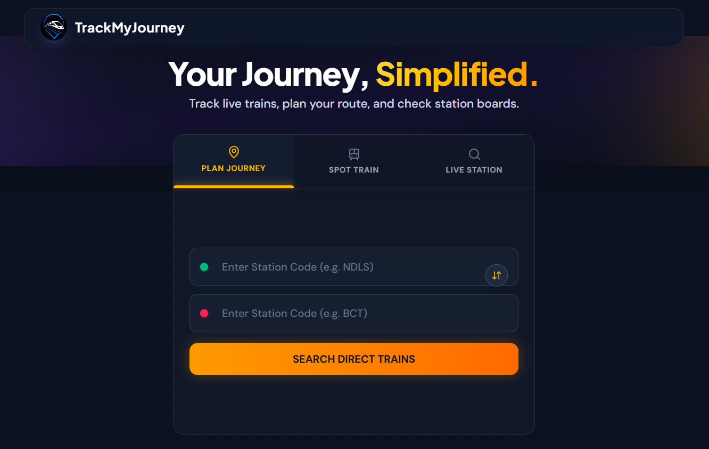
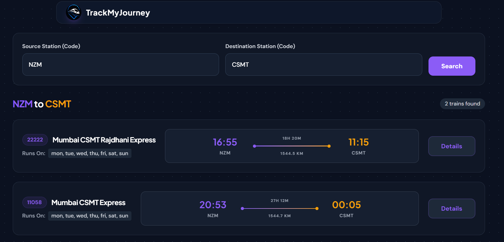
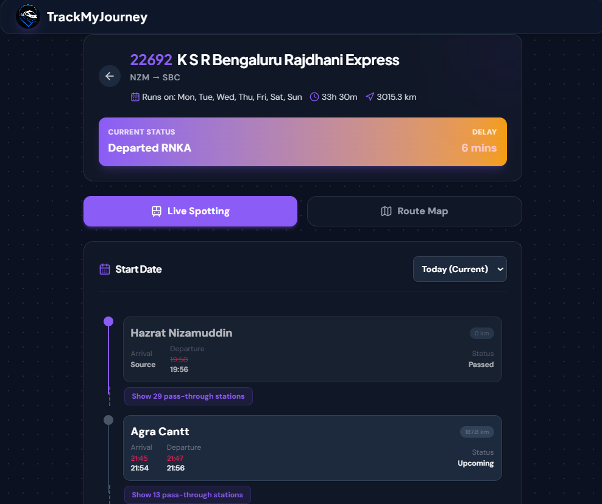
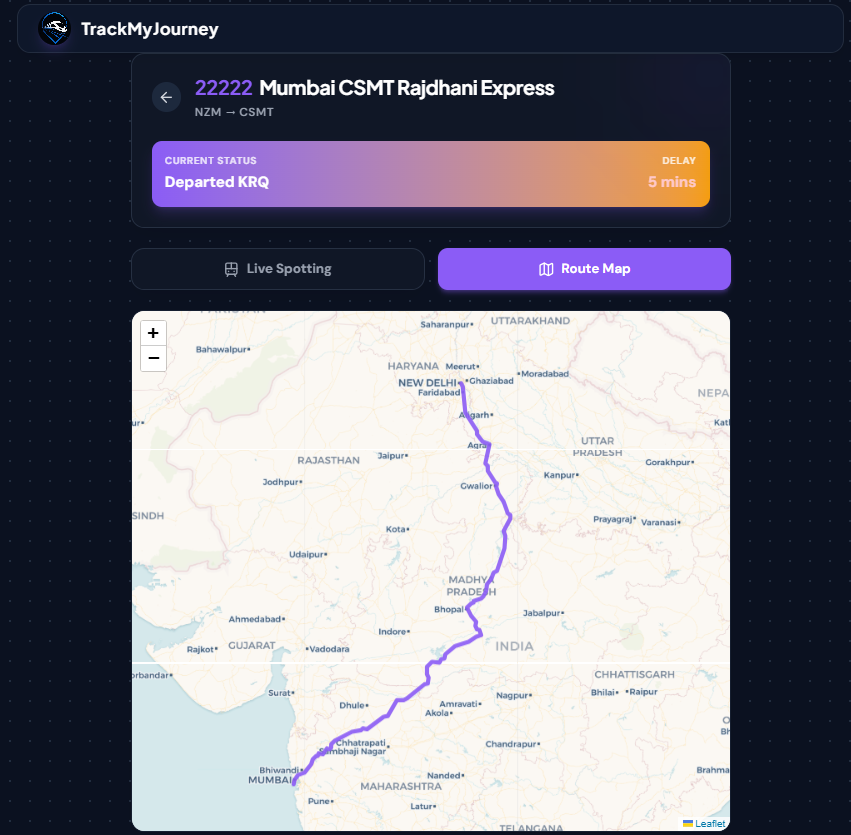
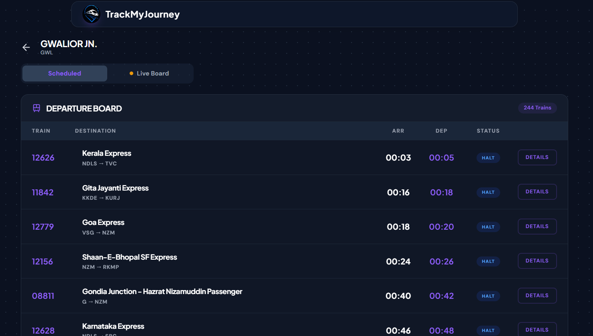
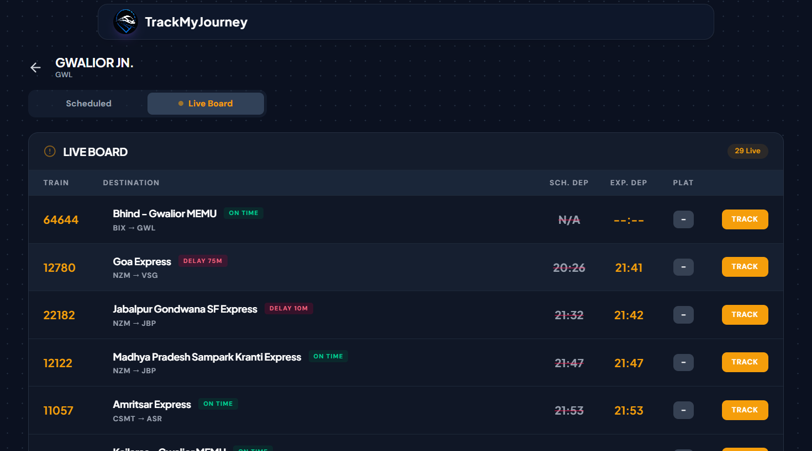

# TrackMyJourney 🚆

TrackMyJourney is a comprehensive web application that allows users to track live train statuses, view journey details, and see routes on an interactive map.


## ✨ Features

- **Live Train Tracking**: Get real-time updates and live status of trains.
- **Interactive Maps**: View train routes and current locations using Leaflet maps.
- **Modern UI**: A responsive, fast, and beautiful user interface built with React and Tailwind CSS.
- **Secure Backend**: Express server with rate limiting, helmet security headers, and robust error handling.

## 📸 Screenshots

Here is a glimpse of the application in action:

<div style="display: grid; grid-template-columns: repeat(2, 1fr); gap: 10px;">
  
  
  
  
  
  
</div>

## 🛠️ Tech Stack

### Frontend
- **React 19** with **Vite**
- **Tailwind CSS v4** for styling
- **React-Leaflet** for interactive maps
- **Zustand** for state management
- **Lucide React** for beautiful icons

### Backend
- **Node.js & Express**
- **MongoDB** (with Mongoose) for database
- **Axios** for external API integrations (RailRadar API)

## 🚀 Getting Started

### Prerequisites
- Node.js (v18 or higher recommended)
- MongoDB installed locally or a MongoDB Atlas URI

### Installation

1. **Clone the repository**
   ```bash
   git clone https://github.com/theniteshgurjar/TrackMyJourney.git
   cd TrackMyJourney
   ```

2. **Setup the Backend**
   ```bash
   cd server
   npm install
   ```
   Create a `.env` file in the `server` directory and add the necessary environment variables:
   ```env
   PORT=5000
   MONGO_URI=your_mongodb_connection_string
   RAILRADAR_API_KEY=your_railradar_api_key
   ```
   Start the backend development server:
   ```bash
   npm run dev
   ```

3. **Setup the Frontend**
   Open a new terminal and run:
   ```bash
   cd client
   npm install
   ```
   Start the frontend development server:
   ```bash
   npm run dev
   ```

## 📂 Project Structure

```text
TrackMyJourney/
├── client/          # React frontend (Vite, Tailwind, Leaflet)
├── server/          # Express backend (MongoDB, Routes, API integrations)
└── .gitignore       # Git ignore rules for the entire project
```

## 📄 License
This project is licensed under the ISC License.
